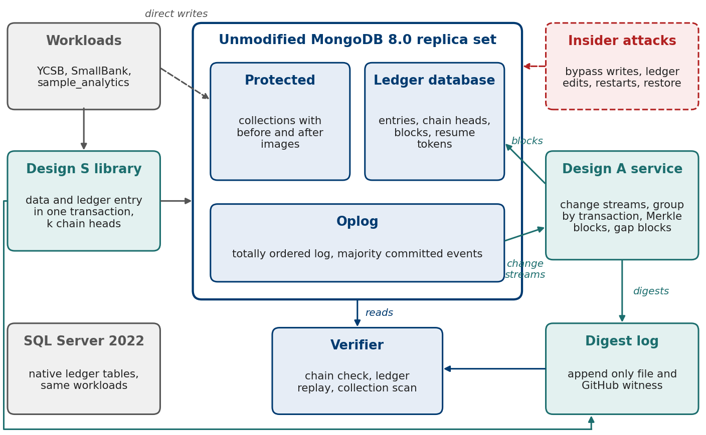

# A Change Stream Ledger for MongoDB

Tamper evidence for an unmodified MongoDB 8.0 replica set, compared with the native ledger of
SQL Server 2022. COMP.8157 Advanced Database Topics, Fall 2026, University of Windsor
(Dr. Andreas S. Maniatis).

Team: Olumide Ogunjebi, Rohith Nelluri, Yadu Pratap.

| | Link |
|---|---|
| Code repository (this page) | https://github.com/OlumideOgunjebi/mongoledger |
| Project management (Hive) | https://projects.hive.com/?shareToken=avt_9Q3eSs2szmzB2ezkZoZhHxzNcdWdDfMwERWWXs7WgJQZMKusetkc5EpM87Ac2yA4 (how the project is managed: `docs/PROJECT_MANAGEMENT.md`) |
| Run it in the browser, no installation | GitHub Codespaces: **Code → Codespaces → Create codespace on main** (or https://codespaces.new/OlumideOgunjebi/mongoledger) |
| Continuous integration | **Actions** tab: unit tests, then integration tests and the demo on a live MongoDB 8.0 |
| Every file, its owner and purpose | `SOURCE_FILES.md` |



## Project documents (D.3, D.4 and D.5)

| Deliverable | Where |
|---|---|
| D.3.1 Midterm Project Status Report | `docs/D.3.1 Midterm Project Status Report.pdf` (and `.docx`); team form `docs/D.3.1.1 Team Contribution Form, Team 3.pdf` |
| D.4.1 User Requirements and Analysis | `docs/D.4.1 User Requirements and Analysis.pdf` (and `.docx`) |
| D.4.2 Design | `docs/D.4.2 Design Document.pdf` (and `.docx`) |
| D.4.3 Application | this repository: source in `ledger/`, `workloads/`, `bench/`, `attacks/`, `sqlserver/`; executables in `dist/`; datasets in `datasets/`; schemas in `schema/`; file list in `SOURCE_FILES.md`; project management in `docs/PROJECT_MANAGEMENT.md` |
| D.4.3 submission document | `docs/D.4.3 Project Full Application, Team 3.pdf` (and `.docx`) |
| D.4.4 Deployment | `docs/D.4.4 Deployment Document.pdf` (and `.docx`) |
| D.4.5 User Guide | `docs/D.4.5 User Guide.pdf` (and `.docx`) |
| D.5 Final Project Report | `docs/D.5 Final Project Report, Team 3.pdf` (and `.docx`) |

## What the code does

Two designs record every change to the protected collections in a hash linked ledger that lives in
MongoDB itself, and publish small digests to a log kept outside the database.

| | Design S (synchronous) | Design A (asynchronous) |
|---|---|---|
| Where entries are written | inside the application's own multi document transaction, through the `SyncLedger` library | by a separate service that reads the majority committed change stream |
| Chain | k partitioned chain heads (a hash of the document key picks the head) | one chain of Merkle blocks; each transaction is one subtree |
| Sealing | `fold` moves committed entries into a Merkle block | the service seals a block every interval |
| Catches writes that skip the application | no (they never reach the library); the state scan and the cross check expose them | yes, every committed write appears in the change stream |
| Cost on the write path | extra reads and writes inside each transaction | no application change; the server stores a before image per update, and protection arrives after a delay |

The verifier (`ledger/verifier.py`) checks the block chain and every block hash, compares the blocks
with the external digest log, replays the ledger into an expected state, and compares that with a
full scan of the protected collections. Each problem becomes a finding with a kind and a severity
(`alert`, `warning`, `info`), for example `modified_document`, `digest_without_block`,
`broken_link`, `gap` or `write_outside_library`.

Hashing follows RFC 9162 (Certificate Transparency 2.0): leaves are hashed with a `0x00` prefix and
inner nodes with `0x01`, and inclusion proofs are checked with the algorithm of section 2.1.3.2.
Documents are hashed from canonical Extended JSON with sorted keys after a BSON round trip, so the
hash is the same whether it is computed from a change event or from a later scan.

## Run it without installing anything (GitHub Codespaces)

1. On the repository page choose **Code → Codespaces → Create codespace on main**.
2. Wait for the container to build (about two minutes the first time). MongoDB 8.0 starts as a
   replica set and the project is installed automatically (`.devcontainer/`).
3. In the terminal run `python demo.py`, or any command below, for example
   `mongoledger --collections accounts verify --design A`.

## Open it as a VS Code project

The repository is saved as a VS Code project: open the folder, or `mongoledger.code-workspace`, in
VS Code or a codespace. `.vscode/launch.json` holds run and debug configurations for the demo, setup,
the Design A service, verification and the tests; `.vscode/tasks.json` holds the quick start, health
check, demo, test, attack and build tasks; the Testing panel discovers the pytest suite.

## Quick start on your own computer

Requirements: Docker Desktop (or Docker Engine with the compose plugin), Python 3.10 or newer, Git.

```bash
bash scripts/quickstart.sh                                   # macOS, Linux, WSL, Git Bash
powershell -ExecutionPolicy Bypass -File scripts\quickstart.ps1   # Windows PowerShell
```

Each script creates `.env` from `.env.example`, starts MongoDB with `docker compose up -d --wait mongo`,
creates `.venv`, installs the project (`pip install -e ".[bench,test]"`), runs the tests and runs the
demonstration. `bash scripts/health_check.sh` (or `scripts\health_check.ps1`) then checks the
replica set, the ledger and the digests and prints PASS or FAIL for each.

By hand:

```bash
cp .env.example .env                      # set MSSQL_SA_PASSWORD before starting SQL Server
docker compose up -d --wait mongo
python -m venv .venv && source .venv/bin/activate      # Windows: .\.venv\Scripts\Activate.ps1
pip install -e ".[bench,test]"
python -m pytest -q tests                 # unit tests; live tests run when MONGO_URI is set
export MONGO_URI="mongodb://localhost:27017/?replicaSet=rs0&directConnection=true"
python -m pytest -v tests/integration
python demo.py
```

`demo.py` loads 1,000 SmallBank customers, runs 20 seconds of transactions through Design S while
the Design A service and the Design S folder run beside it, verifies both ledgers, then performs
three attacks (a write that bypasses the library, an edit of a sealed ledger entry, and a rollback
of the newest ledger block) and prints what each design detects.

## Using the ledger

The `mongoledger` command is installed with the package; `python -m ledger.cli` is the same program.
Global options come first: `--uri`, `--data-db` (default `bank`), `--collections` (comma separated,
default `accounts`), `--digest-log`, `--git-witness PATH`, `-v`.

```bash
mongoledger --collections accounts setup --heads 4      # images, indexes, baselines (safe to repeat)
mongoledger service --interval 5                        # Design A service (Ctrl+C to stop)
mongoledger fold --heads 4 --every 5                    # Design S sealing loop
mongoledger verify --design A --cross                   # JSON report; exit code 2 on any alert
mongoledger verify --design S

mongoledger history --design A --key 42                 # every recorded version of document 42
mongoledger history --design A --op delete --since 2026-11-01 --until 2026-11-02
mongoledger blocks --design A --last 10                 # blocks with counts and commit to block lag
mongoledger digests --design A                          # published digests: ok, MISMATCH, MISSING BLOCK
mongoledger prove --design A --key 42                   # RFC 9162 inclusion proof for the newest version
```

Application code writes through Design S like this:

```python
from pymongo import MongoClient
from ledger.design_s import SyncLedger

client = MongoClient("mongodb://localhost:27017/?replicaSet=rs0&directConnection=true")
ledger = SyncLedger(client, "bank", heads=4)

def transfer(t):
    t.update_one("accounts", {"_id": 1}, {"$inc": {"checking": -500}})
    t.update_one("accounts", {"_id": 2}, {"$inc": {"checking": 500}})

ledger.transaction(transfer)   # data changes and ledger entries commit together, or not at all
```

## Workloads and datasets

| Workload | Data | Command |
|---|---|---|
| SmallBank (Alomari et al., ICDE 2008), BenchBase mix | generated, `n` customers | `python -m bench.run --target mongo-plain mongo-a mongo-s ...` |
| sample_analytics trading | MongoDB's sample dataset in `datasets/sample_analytics/` (source and checksums in `datasets/README.md`) | `python -m workloads.analytics load` then `python -m bench.run --workload analytics ...` |
| YCSB 0.17.0 workloads A and B | generated by YCSB | `bash ycsb/run_ycsb.sh mongo-a a` (see `ycsb/README.md`) |

## Experiments

```bash
python -m bench.run --target mongo-plain mongo-a mongo-s --clients 1 4 16 32 --seconds 60 --repeats 5
python -m bench.run --target mongo-s --heads 1 4 16 --clients 16
python -m bench.run --target mongo-a --interval 1 5 30 --clients 16
python -m bench.run --target sql-plain sql-ledger --clients 1 4 16 32     # needs docker compose up -d mssql
python -m bench.run --workload analytics --target mongo-plain mongo-a mongo-s --clients 8
python -m bench.plot                       # results/fig_throughput.png, fig_p95.png, fig_lag.png
python -m bench.plot --workload analytics
```

Each run resets its data, loads it, starts the process its target needs, measures a closed loop
run, waits for the last block to seal, and verifies. One row per run is appended to
`results/summary.csv`. Run one database at a time; the compose file limits each container to two
CPUs and 4 GB.

SQL Server baseline (needs the Microsoft ODBC Driver 18 and `pip install -e ".[sqlserver]"`):

```bash
docker compose up -d --wait mssql
python -m sqlserver.ledger_baseline schema
python -m sqlserver.ledger_baseline digest
python -m sqlserver.ledger_baseline verify
```

On Apple Silicon, SQL Server has no arm64 image; turn on Rosetta emulation in Docker Desktop or run
the SQL Server part on a Windows or Intel computer.

## Attack suite

```bash
python -m attacks.run_attacks bypass          # write that skips the Design S library
python -m attacks.run_attacks edit-ledger     # change a sealed entry in each design
python -m attacks.run_attacks tail            # rewrite Design S entries before they are folded
python -m attacks.run_attacks churn          # with the service stopped, write until older oplog history is gone
bash attacks/standalone_write.sh 1            # restart outside replica set mode and write
bash attacks/restore_backup.sh snapshot       # later: rollback, dump, restore-data
python -m attacks.run_attacks report          # verify both designs and log the outcome
```

Every action and verification result is appended to `results/attacks.jsonl`.

## Tests and continuous integration

`python -m pytest -q tests` runs the unit tests on an in memory stand in for MongoDB
(`tests/fake_mongo.py`); `tests/integration` runs against a live replica set when `MONGO_URI` is
set. `.github/workflows/tests.yml` runs both on every push, then the demo and a short SmallBank
comparison, and keeps the output as the `live-results` artifact.

## Executables and packaging

`dist/mongoledger-1.0.0-py3-none-any.whl` is the built package (with the source archive
`dist/mongoledger-1.0.0.tar.gz`): `pip install dist/mongoledger-1.0.0-py3-none-any.whl` installs the
`mongoledger` command and the Python modules on any machine with Python 3.10 or newer. Rebuild it with
`python -m pip wheel . -w dist --no-deps`. Python is interpreted, so the source files are also the
program; `scripts/` holds the start and health check scripts for both shells.

## Database schema and connection

See `schema/README.md`: the logical schema of every MongoDB collection (`schema/mongodb_schema.json`),
the SQL Server tables (`sqlserver/01_schema.sql`) and how to connect with the shell, Compass or
`sqlcmd`. The default connection is `mongodb://localhost:27017/?replicaSet=rs0&directConnection=true`.

## Repository layout

```
ledger/            the ledger: canonical hashing, Merkle trees, entries and blocks, Design S,
                   Design A, storage, digest log, scan, verifier, search, command line
workloads/         SmallBank (MongoDB and SQL Server) and the sample_analytics trading workload
bench/             experiment harness (results/summary.csv) and plots
attacks/           insider attack suite (Python plus two Docker scripts)
sqlserver/         SQL Server 2022 ledger schema, digests and verification
ycsb/              YCSB 0.17.0 runs for MongoDB and SQL Server
datasets/          sample_analytics files with their source; notes on generated data
schema/            MongoDB schema and connection details
scripts/           quickstart and health check for bash and PowerShell
tests/             unit tests on an in memory stand in, plus live integration tests
docs/              D.3 and D.4 documents, architecture figures, project management page
dist/              executables: built wheel and source archive
.vscode/           VS Code project: settings, run and debug configurations, tasks
.devcontainer/     GitHub Codespaces environment (MongoDB replica set plus Python)
demo.py            two minute end to end demonstration
```

## Team and ownership

| Member | Leads | Main folders |
|---|---|---|
| Olumide Ogunjebi | threat model, attack suite, verifier, search commands | `attacks/`, `ledger/verifier.py`, `ledger/search.py` |
| Rohith Nelluri | ledger core, Design S, SQL Server baseline | `ledger/` core, `ledger/design_s.py`, `sqlserver/` |
| Yadu Pratap | Design A service, workloads, analysis | `ledger/design_a.py`, `workloads/`, `bench/`, `ycsb/` |

Work is tracked in Hive. Each component was committed separately, with a message that names its
owner and the requirements it implements, and the CI workflow tests every push. The main branch is
protected, so later changes go through a pull request that another member approves.

## Known limits

The verifier proves that the ledger, the digests and the data agree; it cannot prove that a change
was legitimate. An administrator who controls both the database and every copy of the digest log can
rewrite history, which is why the digests should also go to a witness outside the team's control
(`--git-witness`). Design A seals changes after a delay, so a change is only protected once its block
is sealed and published. If the service stops for longer than the oplog window, the lost history is
recorded as a gap block and the next full scan decides whether any protected document changed during
the gap. The testbed runs a single node replica set without authentication; a production deployment
would add TLS, users with least privilege and at least three members.
